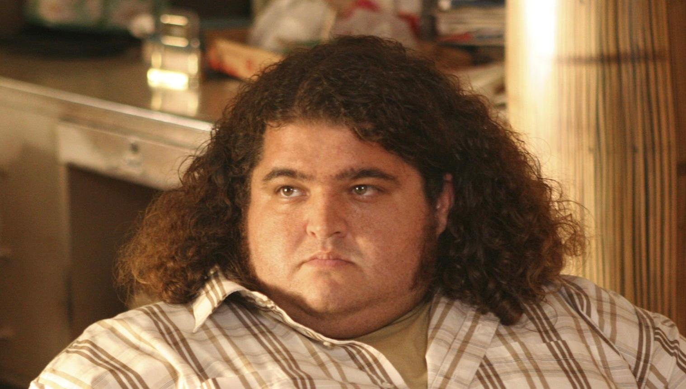

# 🏝️ The Numbers



<div align="center">
  <h3>4 8 15 16 23 42</h3>
</div>

---

How many tries does it take to hit Hurley's cursed lottery numbers by pure luck?

A small .NET console app that keeps drawing random numbers until it matches the sequence, then reporst how many attempts it took. Hobby project, just for fun.

## 🎰 How it works

1. Draw 6 unique random numbers from 1-42, like a classic 6/42 lottery
2. Compare them to the target numbers (order matters, it has to be the exact sequence)
3. No match? Draw again
4. On a match, print the total number of tries and the time it took

## 🚀 Run it

Requires the [.NET SDK](https://dotnet.microsoft.com/)

```bash
git clone https://github.com/Sanjero20/the-numbers.git
cd the-numbers
dotnet run -c Release --project src/TheNumbers
```

## 🧮 The Odds

This draws 6 different numbers from 1-42 and requires the **exact sequence**, in order.

42 × 41 × 40 × 39 × 38 × 37 = 3,776,965,920 possible ordered draws, so the odds are **1 in 3,776,965,920**.

> For comparison, a regular 6/42 ticket where order doesn't matter is only 1 in 5,245,786. Demanding the exact order makes it 720 times harder.

## 🧠 Why?

Because the numbers are bad luck, and I wanted to see how bad.

First seen in \*\*Lost S1E18, "Numbers"
